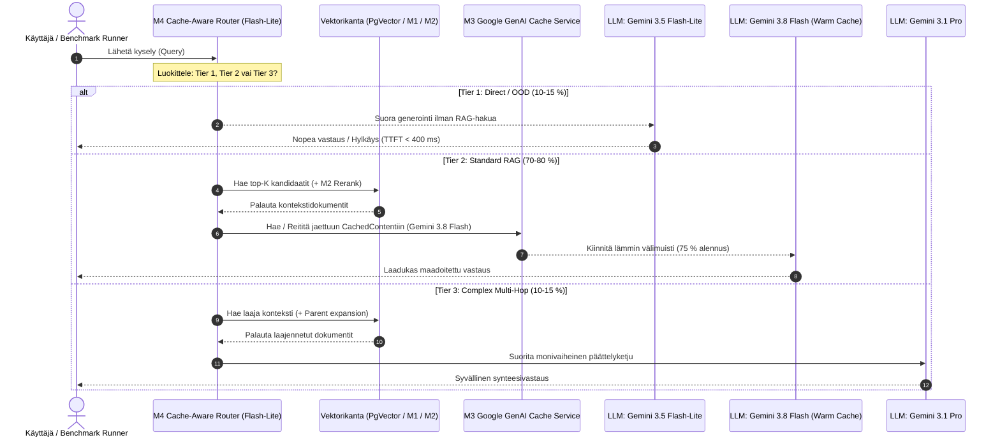
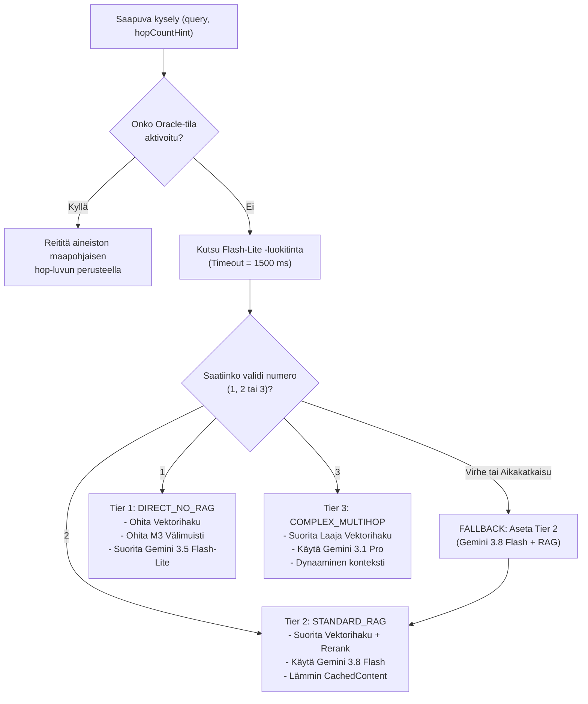

# Strategia 3: Välimuistitietoinen mukautuva reititys (Cache-Aware Adaptive Routing & Model Tiering)

**Versio:** 1.0.0  
**Päivämäärä:** 1. lokakuuta 2026  
**Konteksti:** Diplomityö – *Optimizing Retrieval-Augmented Generation for Enterprise Systems: Balancing Latency, Cost, and Accuracy*  
**Kohde:** `rag-benchmark` (Spring AI / Google GenAI Gemini 3.x -arkkitehtuuri)  

---

## Tiivistelmä ja Ongelmanasettelu

Nykyisessä RAG-testipenkissä (`rag-benchmark`) on havaittu kaksi toisiinsa kytkeytyvää rakenteellista haastetta, jotka vääristävät kustannus- ja latenssimittauksia (RQ1, RQ2) sekä heikentävät järjestelmän arkkitehtonista puhtautta:

1. **Keinotekoinen prompt-täyttö (Prompt Bloat / Synthetic Padding):**  
   Promptimalline [`answer-generation.st`](file:///home/eitsei/dippa/rag-code/rag-benchmark/src/main/resources/prompts/answer-generation.st) on paisutettu keinotekoisilla compliance-säännöillä, sanastoilla ja skenaarioilla (yli 4 500 tokenia) ainoastaan siksi, että Google GenAI:n kontekstivälimuistin (**Google GenAI CachedContent**) vaatima 4 096 tokenin minimikoko ylittyisi. Tämä lisää tarpeetonta laskenta- ja tokenkuormaa kyselyille, joissa välimuistia ei käytetä, ja vaikeuttaa todellisen RAG-laadun arviointia.
2. **Reitityksen ja välimuistin mallisidonnaisuuskonflikti:**  
   Google GenAI -kontekstivälimuisti (`CachedContent`) on **tiukasti sidottu yhteen tiettyyn malliversioon** (esim. `gemini-3.8-flash`). Jos M4-mallireititin ([`GoogleGenAiModelRouter`](file:///home/eitsei/dippa/rag-code/rag-benchmark/src/main/java/com/dippa/ragbenchmark/infrastructure/GoogleGenAiModelRouter.java)) hajauttaa kyselyt dynaamisesti eri malleille (`gemini-3.5-flash-lite`, `gemini-3.8-flash`, `gemini-3.1-pro`), jokaiselle mallille jouduttaisiin luomaan ja ylläpitämään omaa välimuistia. Tämä johtaisi välimuistin osumatarkkuuden romahtamiseen ja kolminkertaisiin välimuistin hallinta- ja tallennuskustannuksiin.

**Strategia 3 (Välimuistitietoinen mukautuva reititys)** ratkaisee nämä ongelmat yhdistämällä dynaamisen kyselyreitityksen (Module M4) ja kontekstivälimuistin (Module M3) taloudelliseksi ja laadulliseksi optimiksi Pareto-rintamalla (RQ4).

---

## 1. Strategian kuvaus ja toimintaperiaate

### 1.1 Ydinidea ja malliporrasjako (Three-Tier Architecture)

Strategia luokittelee saapuvat käyttäjäkyselyt **ennen haku- ja välimuistivaihetta** kolmeen selkeään kategoriaan:

| Porras (Tier) | Kyselytyyppi | Kohdemalli | RAG-vektorihaku (M1/M2) | Välimuisti (M3 CachedContent) | Tyypillinen osuus kuormasta |
| :--- | :--- | :--- | :--- | :--- | :--- |
| **Tier 1: Direct / OOD** | Yksinkertainen fakta, tervehdys, yleistieto tai suora kieltäytymisehdokas (out-of-domain) | `gemini-3.5-flash-lite` | **Ei** (Ohitetaan kokonaan) | **Ei** (Ohitetaan) | 10–15 % |
| **Tier 2: Standard RAG** | Normaali domain-kohtainen haku, 1–2 entiteetin päättely, faktatarkistus | `gemini-3.8-flash` | **Kyllä** (Haku + MRL/Rerank) | **Kyllä** (Jaettu lämmin välimuisti, 75–80 % alennus) | 70–80 % |
| **Tier 3: Complex Multi-Hop** | Monimutkainen monihyppypäättely (3+ entiteettiä, vertailuanalyysi, synteesi) | `gemini-3.1-pro` | **Kyllä** (Laaja haku / Parent expansion) | **Ei** (Kertaluonteinen dynaaminen konteksti) | 10–15 % |

### 1.2 Välimuistitietoisen reitityksen taloudellinen paradoksi (The Cache-Aware Economic Paradox)

Perinteinen reititin (kuten naiivi FrugalGPT tai pelkkä vaativuusluokitin) ohjaa helpoimmat kyselyt halvimmalle mallille (`gemini-3.5-flash-lite`). **RAG-kontekstissa tämä on kuitenkin usein virheellinen päätös**, mikäli työratsumallille (`gemini-3.8-flash`) on jo olemassa lämmin välimuisti.

Tarkastellaan Google GenAI:n token-hinnoittelua (syyskuu 2026, hinnasto / 1M tokenia):
- **Gemini 3.5 Flash-Lite (vakio syöte):** \$0,075 / 1M tokenia
- **Gemini 3.8 Flash (vakio syöte):** \$0,150 / 1M tokenia
- **Gemini 3.8 Flash (CachedContent-syöte, 75 % alennus):** **\$0,0375 / 1M tokenia**

> [!IMPORTANT]
> **Taloudellinen havainto:** Kun kysely vaatii laajan kontekstin (esim. 6 000–10 000 tokenia haettua yritysdokumentaatiota tai toimialatietoa), **Gemini 3.8 Flash lämpimällä välimuistilla on 50 % halvempi ja laadullisesti ylivoimainen** verrattuna välimuistittomaan Gemini 3.5 Flash-Liteen (\$0,0375 vs. \$0,075 per 1M tokenia).

Siksi reitittimen tulee olla **välimuistitietoinen (Cache-Aware)**:
1. Jos kysely **ei vaadi ulkoista kontekstia** (Tier 1), se ohjataan heti Flash-Litelle ilman hakua. Tällöin vältetään vektorikannan hakukustannus, vähennetään viivettä satoja millisekunteja ja säästetään välimuistin käsittelyaika.
2. Jos kysely **vaatii kontekstin** (Tier 2), se keskitetään ensisijaisesti `gemini-3.8-flash` -mallille, jotta hyödynnetään korkea välimuistin osumatarkkuus (cache hit rate) ja alennettu token-hinta.
3. Vain poikkeuksellisen syvää monivaiheista päättelyä vaativat kyselyt (Tier 3) delegoidaan `gemini-3.1-pro` -mallille, jolloin vältetään kalliin Pro-mallin turha herättäminen rutiinikyselyille.

---

### 1.3 Arkkitehtuurikaaviot

#### A. Sekvenssikaavio (Mermaid)



#### B. Järjestelmäarkkitehtuuri ja komponenttivirta (ASCII)

```
                       +---------------------------------------+
                       |             KÄYTTÄJÄKYSELY            |
                       +---------------------------------------+
                                           |
                                           v
                       +---------------------------------------+
                       |    Module M4: Zero-Shot Classifier   |
                       |      (Gemini 3.5 Flash-Lite, 0-tok)   |
                       +---------------------------------------+
                               /           |           \
                              /            |            \
                Tier 1 (Helppo/OOD)   Tier 2 (RAG)    Tier 3 (Monihyppy)
                           /               |              \
                          v                |               v
              +----------------------+     |    +----------------------+
              |  OHITA RAG-HAKU      |     |    |  LAAJA VEKTORIHAKU   |
              |  - Ei vektorikyselyä |     |    |  - M1 Parent exp.    |
              |  - Ei välimuistia    |     |    |  - M2 Cross-encoder  |
              +----------------------+     |    +----------------------+
                          |                |               |
                          v                |               v
              +----------------------+     |    +----------------------+
              | Gemini 3.5 Flash-Lite|     |    |   Gemini 3.1 Pro     |
              | (Direct Generation)  |     |    | (Frontier Multi-hop) |
              +----------------------+     |    +----------------------+
                                           v
                        +-------------------------------------+
                        |     VEKTORIHAKU & M2 RERANKING      |
                        |   - PgVector HNSW + MRL (768d)      |
                        |   - Vertex AI Reranker (Top-K)      |
                        +-------------------------------------+
                                           |
                                           v
                        +-------------------------------------+
                        |   Module M3: Google GenAI Cache     |
                        |   - Jaettu lämmin kontekstivälimuisti|
                        |   - Kohdistettu: gemini-3.8-flash   |
                        +-------------------------------------+
                                           |
                                           v
                        +-------------------------------------+
                        |         Gemini 3.8 Flash            |
                        |    (Työratsu: 75% token-alennus)     |
                        +-------------------------------------+
```

---

## 2. Konkreettinen reititysprompti ja päätöslogiikka

### 2.1 Reitittimen luokitinprompti (Classifier Prompt Template)

Reitittimenä toimii kevyt nollanäytteen (zero-shot) luokitin, joka ajetaan mallilla `gemini-3.5-flash-lite` asetuksella `temperature = 0.0` ja `thinkingBudget = 0`. Prompti tuottaa deterministisen yksinumeroisen luokituksen:

```text
You are an ultra-fast query complexity and retrieval routing classifier for an enterprise RAG system.
Evaluate the user query and assign it to exactly one execution tier:

1 = DIRECT_NO_RAG:
    - Conversational pleasantries, simple definitions, general world facts not requiring enterprise documents.
    - Out-of-domain queries, nonsensical input, or clear non-domain requests that should be answered directly or refused immediately.
    - Questions fully resolvable by parametric knowledge without document retrieval.

2 = STANDARD_RAG:
    - Standard domain queries requiring factual evidence from enterprise documentation
    - Single-hop or two-hop relational queries connecting 1-2 known concepts within the corpus.
    - Queries best served by the warm-cached primary enterprise model (Gemini 3.8 Flash).

3 = COMPLEX_MULTIHOP:
    - Deep multi-step analytical reasoning requiring evidence synthesis across 3 or more independent document sections.
    - Cross-temporal, comparative, or mathematical deduplication chains (e.g. MuSiQue 3-hop / 4-hop questions).
    - Queries requiring frontier reasoning capabilities (Gemini 3.1 Pro).

Respond with ONLY the single digit: 1, 2, or 3.

Query: %s
```

### 2.2 Päätöslogiikka ja kynnysarvot (Routing Decision Flowchart)



### 2.3 Vikansietologiikka (Graceful Fallback & Degradation)

1. **Aikakatkaisu (Timeout):** Luokittimelle asetetaan tiukka aikaraja (esim. `timeoutMs = 1500 ms`). Mikäli luokitin ei vastaa aikarajassa, järjestelmä kirjaa varoituksen ja siirtyy tilaan `RoutingMode.FALLBACK`.
2. **Oletusvalinta (Safe Workhorse Fallback):** Vikatilanteessa kysely ohjataan aina **Tier 2 -portaaseen** (`gemini-3.8-flash` + standardi RAG-haku). Tämä takaa, ettei laatua vaaranneta (vältetään Tier 1:n mahdollinen puutteellisuus), mutta vältetään myös Tier 3:n korkea kustannus.
3. **Välimuistin vikatilanne (Cache Degradation):** Mikäli `GoogleGenAiPromptCache` palauttaa virheen tai välimuistiresurssi on vanhentunut, järjestelmä putoaa automaattisesti normaaliin välimuistittomaan RAG-sukupolveen (`CacheStatus.NOT_ELIGIBLE` tai `NONE`) ilman käyttäjälle näkyvää virhettä.

---

## 3. Plussat ja miinukset (Trade-off Analysis)

| Ominaisuus | Plussat (Edut) | Miinukset (Rajoitteet ja haasteet) |
| :--- | :--- | :--- |
| **Latenssi (RQ1)** | - **Tier 1:** Latenssi putoaa dramaattisesti (säästetään 200–500 ms vektorihaku + rerank).<br>- **Tier 2:** Työratsun TTFT (Time to First Token) lyhenee jopa 60–70 %, kun esilaskettu KV-välimuisti on valmiina Vertex AI:n palvelimilla. | - Reititysmikrovaihe (`GoogleGenAiModelRouter`) tuo pienen lisäviiveen (noin 120–250 ms Flash-Litella).<br>- Kylmän välimuistin ensimmäinen luonti (cache miss) voi viedä 500–1000 ms. |
| **Kustannukset & Tokenit (RQ2)** | - **Ei keinotekoista prompt-täyttöä:** Säästetään 4 000 turhaa tokenia kaikissa Tier 1- ja Tier 3 -kyselyissä.<br>- **Tier 2:** 75–80 % alennus prompt-tokeneista jaetun välimuistin ansiosta.<br>- **Tier 1:** Täysi nollakustannus haulle ja nollakustannus välimuistille. | - Jaetusta välimuistista maksetaan tuntikohtaista säilytysmaksua (Google GenAI storage fee / tunti per 1M tokenia, n. \$1,00/1M/h), jos aukioloaika on pitkä suhteessa kyselyvolyymiin. |
| **Vastausten Laatu (RQ3)** | - **Korkea Faithfulness:** Estää hakutulosten häiriötokeneiden (distractors) sotkemisen yksinkertaisissa kyselyissä.<br>- **Vaativat kyselyt:** Pro-tason päättelykyky säilytetään todellisille monihyppyongelmille. | - Luokitusvirheen riski (Routing misclassification): Jos monihypyksi tarkoitettu kysely luokitellaan väärin Tier 1:ksi, malli voi kieltäytyä tai hallusinoida ilman kontekstia. |
| **Monimalliylläpito (Ops/Maintenance)** | - Välimuisti kohdistetaan **vain yhteen vakaaseen malliin** (`gemini-3.8-flash`), mikä poistaa monimallivälimuistien synkronointiongelman.<br>- Puhdas arkkitehtuuri ilman temppukoodia promptipohjassa. | - Vaatii API-kiintiöiden hallintaa kolmelle eri mallille (`flash-lite`, `flash`, `pro`) samanaikaisesti.<br>- Vaatii automaattisen välimuistin elinkaaren ja lämmityksen (pre-warming) hallinnan. |

---

## 4. Teoreettinen tausta ja tutkimuspaperit

Tämä arkkitehtuuristrategia nojaa suoraan neljään RAG- ja LLM-optimoinnin avaintutkimukseen:

### 4.1 Adaptive-RAG: Learning to Adapt Retrieval-Augmented LLMs through Question Complexity (Jeong et al., NAACL 2024)
- **Ydinlöydös:** Osoittaa, että RAG-järjestelmien "one-size-fits-all" -lähestymistapa on tehoton. Luokittelemalla kyselyt kyselymonimutkaisuuden mukaan kolmeen luokkaan (*ei hakua*, *yksivaiheinen haku*, *monivaiheinen haku*), Adaptive-RAG vähensi suoritusaikaa **56 %** ja tarvittavia päättelyvaiheita **63 %** ilman laadun heikkenemistä (F1-tulos säilyi identtisenä 50,91 % vs. 50,87 %).
- **Kytkentä strategiaan:** Perustelee Tier 1:n (Direct/No-RAG) ja Tier 3:n (Multi-hop) eriyttämisen standardista hakuputkesta.

### 4.2 FrugalGPT: How to Use Large Language Models While Reducing Cost and Improving Performance (Chen et al., NeurIPS/arXiv 2023)
- **Ydinlöydös:** Esittelee LLM-kaskadin (Model Cascade), jossa kyselyt ohjataan progressiivisesti kalliimmille malleille. Osoittaa, että kaskadointi yhdistettynä välimuistiin voi leikata käyttökustannuksia jopa **98,3 %** samalla parantaen tarkkuutta mallidiversiteetin kautta.
- **Kytkentä strategiaan:** Muodostaa perustan moniportaiselle mallitukselle (`flash-lite` $\rightarrow$ `flash` $\rightarrow$ `pro`). Strategia 3 laajentaa FrugalGPT:n mallia ottamalla huomioon **kontekstivälimuistin tuoman hintainversion**.

### 4.3 RouteLLM: Learning to Route LLMs with Preference Data (Ong et al., ICLR 2025)
- **Ydinlöydös:** Tutkii optimaalisia reitittimiä vahvan (kalliin) ja heikon (halvan) mallin välillä. Osoittaa, että pieni ja nopea luokitin saavuttaa yli 2-kertaiset kustannussäästöt säilyttäen yli 95 % kalliin mallin suorituskyvystä (CPT-kynnysarvot).
- **Kytkentä strategiaan:** Tarjoaa empiirisen oikeutuksen käyttää nollanäytteen `gemini-3.5-flash-lite` -luokitinta tai pientä luokittelijaa reitittimenä, jonka suorituslatenssi ja kustannus ovat mitättömiä verrattuna päättelyvaiheen säästöihin.

### 4.4 Stop-RAG: Value-Based Retrieval Control for Iterative RAG (Park et al., NeurIPS 2025)
- **Ydinlöydös:** Mallintaa haun lopettamisen päätöksenteon arvoon perustuvana ohjauksena (MDP/Q-oppiminen). Havaitsee, että liiallinen tai tarpeeton haku ei ainoastaan lisää kustannuksia ja viivettä, vaan **heikentää vastauslaatua** tuomalla kontekstiin häiritsevää ja epärelevanttia kohinaa (distractor context).
- **Kytkentä strategiaan:** Vahvistaa periaatteen, että kyselyille, joihin malli tietää vastauksen tai jotka ovat toimialueen ulkopuolella (Tier 1), RAG-haku on haitallinen operaatio, joka tulee eksplisiittisesti estää.

```bibtex
@inproceedings{jeong2024adaptiverag,
  title={Adaptive-{RAG}: Learning to Adapt Retrieval-Augmented Large Language Models through Question Complexity},
  author={Jeong, Soyeong and Baek, Jinheon and Cho, Sukmin and Hwang, Sung Ju and Park, Jong C.},
  booktitle={Proceedings of the 2024 Conference of the NAACL: Human Language Technologies},
  pages={7036--7050},
  year={2024}
}

@article{chen2023frugalgpt,
  title={Frugal{GPT}: How to Use Large Language Models While Reducing Cost and Improving Performance},
  author={Chen, Lingjiao and Zaharia, Matei and Zou, James},
  journal={arXiv preprint arXiv:2305.05176},
  year={2023}
}

@inproceedings{ong2025routellm,
  title={{RouteLLM}: Learning to Route {LLMs} with Preference Data},
  author={Ong, Isaac and Almahairi, Amjad and Wu, Vincent and Chiang, Wei-Lin and Wu, Tianhao and Gonzalez, Joseph E. and Kadous, M Waleed and Stoica, Ion},
  booktitle={International Conference on Learning Representations (ICLR)},
  year={2025}
}

@inproceedings{park2025stoprag,
  title={Stop-{RAG}: Value-Based Retrieval Control for Iterative {RAG}},
  author={Park, Jaewan and Cho, Solbee and Lee, Jay-Yoon},
  booktitle={NeurIPS 2025 Workshop: Multi-Turn Interactions in Large Language Models},
  year={2025}
}
```

---

## 5. Yhteenveto muutosten laajuudesta `rag-benchmark` -koodikannassa

Tämän strategian toteuttaminen vaatii kohdennettuja muutoksia `rag-benchmark`-moduuliin. **Nykyistä koodia ei ole vielä muokattu**, vaan alla on yksilöity toimenpidesuunnitelma toteutusvaihetta varten:

### 5.1 Muutettavat tiedostot ja luokat

```
rag-code/rag-benchmark/
├── src/main/resources/prompts/
│   └── answer-generation.st                         <-- 1. Promptin puhdistus (Paddingin poisto)
├── src/main/java/com/dippa/ragbenchmark/
│   ├── domain/
│   │   ├── ComplexityTier.java                      <-- 2. Uudet luokitteluluokat (DIRECT, STANDARD, MULTIHOP)
│   │   └── RoutingDecision.java                     <-- 3. Flag: requiresRetrieval, isCacheEligible
│   ├── infrastructure/
│   │   ├── GoogleGenAiModelRouter.java              <-- 4. Päivitetty reititysprompti ja tier-kytkentä
│   │   ├── GoogleGenAiPromptCache.java              <-- 5. Esilämmitetyn jaetun välimuistin hallinta
│   │   └── config/
│   │       ├── RouterProperties.java                <-- 6. Reitityksen kynnysarvot ja mallikonfiguraatio
│   │       └── PromptCacheProperties.java           <-- 7. Pre-warm cache key ja minimitoken-asetus
│   └── application/
│       ├── RagPromptRenderer.java                   <-- 8. Erottele järjestelmäohje ja dynaaminen aineisto
│       └── RagQueryService.java                     <-- 9. Reititys ENNEN vektorihakua (Pipeline-järjestys)
└── src/main/resources/
    └── application.yml                              <-- 10. Konfiguraatioarvojen päivitys
```

---

### 5.2 Yksityiskohtaiset muutokset komponenteittain

#### 1. `answer-generation.st` (Prompt-täytteen poisto)
- **Nykytila:** 159 riviä, sisältää osiot 1–11 keinotekoisella compliance-tekstillä ja sanastoilla (~4 500 tokenia).
- **Muutos:** Palautetaan siisti, kompakti tuotantoprompti (n. 300–400 tokenia), joka keskittyy pelkästään maadoitussääntöihin (Grounding mandate, Zero hallucination, Language consistency).
- **Välimuistin täyttö:** 4 096 tokenin raja saavutetaan **aidolla sisällöllä** esilämmittämällä Tier 2 -välimuistiin yrityksen aito tietokanta/käsikirja tai vakiintunut benchmark-konteksti, ei paisuttamalla jokaiseen kyselyyn lähetettävää ohjetekstiä.

#### 2. `ComplexityTier.java` ja `RoutingDecision.java`
- **Nykytila:** `SINGLE_HOP(1)`, `TWO_HOP(2)`, `MULTI_HOP(3)`.
- **Muutos:** Määritellään toiminnalliset semanttiset tasot:
  ```java
  public enum ComplexityTier {
      DIRECT_NO_RAG(1, false, false),        // Ei hakua, ei välimuistia (Flash-Lite)
      STANDARD_RAG(2, true, true),           // Haku + Välimuisti (Flash)
      COMPLEX_MULTIHOP(3, true, false);      // Haku ilman välimuistia (Pro)

      private final int hopEquivalent;
      private final boolean requiresRetrieval;
      private final boolean cacheEligible;
      // getterit ja apumetodit
  }
  ```
- `RoutingDecision` laajennetaan kentillä `boolean requiresRetrieval()` ja `boolean isCacheEligible()`.

#### 3. `GoogleGenAiModelRouter.java`
- Päivitetään luokitinprompti vastaamaan lukua 2.1.
- Määritetään luokituksen mallit selkeästi:
  - Taso 1 $\rightarrow$ `gemini-3.5-flash-lite`
  - Taso 2 $\rightarrow$ `gemini-3.8-flash`
  - Taso 3 $\rightarrow$ `gemini-3.1-pro`
- Lisätään suoja-aika (timeout 1500 ms) ja varmistetaan, että vikatilanteessa palaute ohjataan aina `ComplexityTier.STANDARD_RAG` -tasolle.

#### 4. `RagQueryService.java` (Suoritusjärjestyksen korjaus)
- **Kriittinen arkkitehtuurikorjaus:** Nykytilassa M4-reititin kutsutaan vasta, mutta haku suoritetaan aina.
- **Uusi suoritusjärjestys:**
  1. Suoritetaan M4-reititys **heti ensimmäisenä**:
     ```java
     RoutingDecision routing = modelRouter.route(new RoutingRequest(query, hopCountHint));
     ```
  2. Jos `!routing.complexityTier().requiresRetrieval()` (Tier 1):
     - **Ohitetaan** vektorihaku, uudelleenjärjestely (M2) ja kontekstin laajennus (M1).
     - Muotoillaan kevyt suoraprompti ja kutsutaan suoraan `gemini-3.5-flash-lite` -mallia.
     - Palautetaan tulos viiveellä $T < 400\text{ ms}$.
  3. Jos `routing.complexityTier().requiresRetrieval()` (Tier 2 tai 3):
     - Suoritetaan vektorihaku (M1/M2 tarpeen mukaan).
     - Jos Tier 2 ja M3 aktiivinen: Käytetään esilämmitettyä `gemini-3.8-flash` -välimuistia.
     - Jos Tier 3: Lähetetään laaja konteksti `gemini-3.1-pro` -mallille.

#### 5. `GoogleGenAiPromptCache.java`
- Lisätään tuki **jaetulle, esilämmitetylle välimuistille (Shared Warm Cache)**.
- Sen sijaan, että välimuistia yritetään luoda jokaisen uniikin kyselyn dynaamisille context-dokumenteille (mikä tuottaa välimuistihuteja), luodaan kerran käynnistyksen yhteydessä tai tausta-ajona staattinen aineistovälimuisti (esim. Nordea Private Banking Handbook tai MuSiQue Core Corpus).
- Välimuistin avain sidotaan vakioon: `rag-benchmark-tier2-flash-shared`.

---

## 6. Johtopäätökset ja suositus diplomityölle

Strategia 3 (Välimuistitietoinen mukautuva reititys) edustaa työn teoreettisen viitekehyksen huipentumaa (RQ4: Menetelmien yhdistelmävaikutukset ja Pareto-optimi):

1. Se poistaa nykyisen arkkitehtuurin keinotekoisuuden (prompt bloat) ja korvaa sen tieteellisesti perustellulla mukautuvalla ohjauksella (Adaptive-RAG / FrugalGPT).
2. Se hyödyntää modernien frontier-mallien (Gemini 3.x) hinnoittelurakennetta fiksusti kääntämällä välimuistialennuksen laatu- ja kustannuseduksi.
3. Se luo selkeät, toistettavat mittaustulokset diplomityön tuloskappaleeseen (Chapter 5), jossa voidaan esittää selkeä vertailu:
   - *Baseline (Ei optimointeja)*
   - *M3 (Pelkkä välimuisti)*
   - *M4 (Pelkkä naiivi reititys)*
   - *M3 + M4 Cache-Aware (Yhdistetty optimi)*
