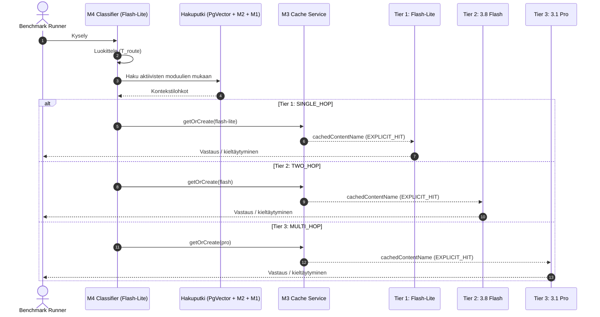

# Strategia 3: Välimuistitietoinen mukautuva malliporrastus (Cache-Aware Model Routing)

**Versio:** 3.1.0 (Päivitetty: kolme mallikohtaista eksplisiittistä välimuistia (Flash-Lite, Flash, Pro), implisiittinen välimuisti poistettu käytöstä, minimikynnys lähteistetty)  
**Päivämäärä:** 6. lokakuuta 2026  
**Konteksti:** Diplomityö – *Optimizing Retrieval-Augmented Generation for Enterprise Systems: Balancing Latency, Cost, and Accuracy*  
**Kohde:** `rag-benchmark` (Spring AI / Google GenAI Gemini 3.x)  
**Metodiviite:** [`04_research_methods.tex`](file:///home/eitsei/dippa/thesis/chapters/04_research_methods.tex) – Taulukko `tab:optimization_modules` (M4: 1-hop → Flash-Lite, 2-hop → Flash, 3/4-hop → Pro)  
**Välimuistidokumentaatio:** [Context cache overview – Limits](https://docs.cloud.google.com/gemini-enterprise-agent-platform/models/context-cache/context-cache-overview#limits)

---

## Tiivistelmä ja lähtötilanne

Strategia määrittelee, miten dynaaminen malliporrastus (M4) ja jaettu staattinen prefiksivälimuisti (M3) yhdistetään niin, että täyden faktorikokeen ($2^4$) ortogonaalisuus säilyy.

### Lähtötilanne koodikannassa
1. **M3 (Shared Static Prefix Caching) on toteutettu** ([`STRATEGY_SHARED_PREFIX_FEWSHOT.md`](file:///home/eitsei/dippa/STRATEGY_SHARED_PREFIX_FEWSHOT.md)):
   - Järjestelmäkehote + 8 few-shot ICL -demonstraatiota (~5 100 tokenia) tallennetaan `CachedContent`-resurssiin.
   - Dynaamiset top-K lohkot ja kysely lähetetään ajonaikaisesti (`cachedContentName`).
   - Välimuistiavain sisältää jo mallinimen ([`RagQueryService.java#L465-L468`](file:///home/eitsei/dippa/rag-code/rag-benchmark/src/main/java/com/dippa/ragbenchmark/application/RagQueryService.java#L465-L468)) → mallikohtaiset välimuistit toimivat valmiiksi.
   - `renderFullPrompt` sisältää samat demot → M3 vaikuttaa **vain laskutukseen ja latenssiin**, ei promptin sisältöön.
2. **M4 (Model Routing) on toteutettu** ([`GoogleGenAiModelRouter`](file:///home/eitsei/dippa/rag-code/rag-benchmark/src/main/java/com/dippa/ragbenchmark/infrastructure/GoogleGenAiModelRouter.java), [`OracleModelRouter`](file:///home/eitsei/dippa/rag-code/rag-benchmark/src/main/java/com/dippa/ragbenchmark/infrastructure/OracleModelRouter.java)) olemassa olevalla [`ComplexityTier`](file:///home/eitsei/dippa/rag-code/rag-benchmark/src/main/java/com/dippa/ragbenchmark/domain/ComplexityTier.java)-enumilla (`SINGLE_HOP` / `TWO_HOP` / `MULTI_HOP`).
3. **Minimikynnys (virallinen dokumentaatio):**
   - Gemini 3 -perhe (implisiittinen ja eksplisiittinen): **4 096 tokenia**.
   - Gemini 3.0 Flash Preview, 3.1 Pro Preview, 3.7 Flash, 3.8 Flash – **vain implisiittinen**: 6 144 tokenia.
   - Sekä `gemini-3.5-flash-lite`, `gemini-3.8-flash` että `gemini-3.1-pro` tukevat eksplisiittistä välimuistia.
   - → ~5 100 tokenin staattinen prefiksi ylittää eksplisiittisen kynnyksen **kaikilla kolmella mallilla**. Nykyinen globaali `min-tokens: 4096` ([`application.yml`](file:///home/eitsei/dippa/rag-code/rag-benchmark/src/main/resources/application.yml)) on oikein, eikä mallikohtaista kynnystä tarvita.

---

## 1. Strategian kuvaus

### 1.1 Kolmiportainen malliporrastus

| Tier | Kyselytyyppi | Malli | Hakuputki | M3 (kun päällä) |
| :--- | :--- | :--- | :--- | :--- |
| **1: `SINGLE_HOP`** | 1-hop faktat, yksinkertaiset määritelmät, OOD-kyselyt | `gemini-3.5-flash-lite` | Konfiguraation mukainen (M1/M2) | ✅ Flash-Lite-välimuisti |
| **2: `TWO_HOP`** | 2-hop relaatiot, in-domain unanswerable | `gemini-3.8-flash` | Konfiguraation mukainen (M1/M2) | ✅ Flash-välimuisti |
| **3: `MULTI_HOP`** | 3–4-hop monihyppypäättely | `gemini-3.1-pro` | Konfiguraation mukainen (M1/M2) | ✅ Pro-välimuisti |

Mallit konfiguroidaan [`ModelCatalogProperties`](file:///home/eitsei/dippa/rag-code/rag-benchmark/src/main/java/com/dippa/ragbenchmark/infrastructure/config/ModelCatalogProperties.java)-luokan kautta, mutta kokeessa ne pidetään kiinteinä metodiluvun mukaisesti (toistettavuus).

> [!IMPORTANT]
> **Ortogonaalisuusperiaate:** M4 valitsee **ainoastaan generointimallin**. Hakuputki (M1/M2), top-K, prompt-sisältö ja M3:n käyttö määräytyvät yksinomaan aktiivisista moduuleista – ei tieristä. Kun M3 on päällä, **jokainen** kysely käyttää valitun mallin eksplisiittistä välimuistia (100 % kattavuus kaikissa konfiguraatioissa).

> [!NOTE]
> **OOD- ja unanswerable-kyselyt:** Kaikki kyselyt kulkevat hakuputken läpi. OOD-kyselyt (enterprise-datan 20 %) ohjautuvat todennäköisesti Tier 1:een, ja generaattori tuottaa haetun kontekstin perusteella kanonisen kieltäytymislauseen. In-domain unanswerable -kyselyt (MuSiQue 20 %) ohjautuvat Tier 2:een tai 3:een. Näin kieltäytymiskäyttäytyminen on vertailukelpoinen molemmissa datasetissä ja Refusal Accuracy / FRR -metriikat pysyvät validina.

### 1.2 Implisiittinen välimuisti poistettu käytöstä

Gemini 3.x -mallit tekevät oletuksena **implisiittistä** prefix-välimuistia. Baselinen (C0) täysi prompti 3.8 Flashilla on ~6 600 tokenia (> 6 144 implisiittinen kynnys), ja Flash-Litella implisiittinen kynnys on 4 096. Ilman toimenpiteitä C0 ja C4 voisivat saada automaattisen välimuistialennuksen samasta staattisesta prefiksistä, mikä sekoittaisi M3:n vaikutuksen.

**Päätös:** Implisiittinen välimuisti poistetaan käytöstä GCP-projektitasolla ([Enable and disable caching](https://docs.cloud.google.com/gemini-enterprise-agent-platform/resources/zero-data-retention#enabling-disabling-caching)). Tällöin:
- Ainoa välimuistimekanismi on M3:n eksplisiittinen `CachedContent` → M3:n vaikutus on täysin eristetty.
- **Verifiointi:** `cacheReadInputTokens` kirjataan jokaisessa konfiguraatiossa. Ei-M3-konfiguraatioissa (C0, C1, C2, C4, C5, C7, C9, C12) arvon on oltava 0; poikkeama on validiteettiuhka, joka raportoidaan.

> [!WARNING]
> Varmista, että implisiittisen välimuistin poistaminen ei estä eksplisiittisen `CachedContent`-resurssin käyttöä (dokumentaation mukaan ZDR-asetukset käsittelevät mekanismeja erikseen). Testaa yhdellä M3-kyselyllä ennen varsinaista ajoa: `cacheReadInputTokens ≈ 5 100`.

### 1.3 Kustannusmalli

Kyselykohtainen kustannus (vastaa metodiluvun yhtälöä `eq:costs`):

$$\text{Cost} = N_{\text{static}} \cdot P_{\text{cached}}^{(m)} + N_{\text{dyn}} \cdot P_{\text{prompt}}^{(m)} + N_{\text{out}} \cdot P_{\text{comp}}^{(m)}$$

Oletukset: $N_{\text{static}} \approx 5\,100$, $N_{\text{dyn}} \approx 1\,500$ (ilman M1:tä; M1:n kanssa jopa ~5 000), $N_{\text{out}} \approx 150$. Hinnat: [`0B_appendix.tex`](file:///home/eitsei/dippa/thesis/chapters/0B_appendix.tex).

| Tier / malli | Prompt $/1M | Cached $/1M | Output $/1M | Ilman M3 | M3:n kanssa | Säästö |
| :--- | ---: | ---: | ---: | ---: | ---: | ---: |
| 1: Flash-Lite | 0,075 | 0,01875 (−75 %) | 0,30 | $0,00054 | $0,00025 | −53 % |
| 2: 3.8 Flash | 0,75 | 0,075 (−90 %) | 3,75 | $0,00551 | $0,00207 | −62 % |
| 3: 3.1 Pro | 1,25 | 0,3125 (−75 %) | 5,00 | $0,00900 | $0,00422 | −53 % |

Huomiot:
- Välimuisti ei tee Flashista Flash-Liten hintaista: dynaamiset tokenit (10×) ja tulostokenit (12,5×) dominoivat. M4:n säästö syntyy siitä, että 1-hop-kyselyt menevät Flash-Litelle; M3:n säästö kertautuu kaikissa tiereissä.
- Alennusprosentti on mallikohtainen (75 % / 90 %). Metodiluvun "90 % discount" -muotoilu korjattava vastaamaan hinnastoa.
- Pron tulostokenit voivat olla selvästi yli 150, jos thinking on päällä (`thinkingBudget`).
- **Välimuistin luonti- ja säilytyskulu** (enintään 3 välimuistia × ~5 100 tokenia × ajon kesto) kirjataan erikseen per konfiguraatio, koska välimuistit nollataan konfiguraatioiden välillä (Internal Validity).

### 1.4 Datasettikohtainen odotettu jakauma

| Datasetti | Tier 1 (Lite) | Tier 2 (Flash) | Tier 3 (Pro) |
| :--- | :--- | :--- | :--- |
| MuSiQue (40 % 2-hop, 40 % 3–4-hop, 20 % unans.) | ~0 % (vain virhereititykset) | ~40–60 % | ~40–60 % |
| Enterprise (40 % 1-hop, 40 % multi-hop, 20 % OOD) | ~40–60 % | ~20–40 % | ~0–20 % |

Seuraukset:
- **MuSiQuessa** Flash-Lite-välimuistia käytetään vähän (luontikulu vähäisellä hyödyllä), ja M4 siirtää merkittävän osan kuormasta Prolle. C4:n odotetaan olevan C0:aa kalliimpi MuSiQuessa – tämä on validi tulos, ei virhe. Pro-välimuisti lieventää tätä C10/C13/C14/C15-konfiguraatioissa.
- **Enterprise-datassa** M4 + M3 tuottaa suurimman säästöpotentiaalin.

---

## 2. Sekvenssikaavio



---

## 3. Reitittimen luokitinprompti

Kevyt nollanäytteen luokitin (`gemini-3.5-flash-lite`, `temperature = 0.0`, `thinkingBudget = 0`). Prompti ei sisällä viittauksia benchmark-datasetteihin (vältetään vuoto ja säilytetään yleistettävyys):

```text
You are a query complexity classifier for an enterprise retrieval-augmented question answering system.
Estimate how many independent reasoning steps (evidence passages) are needed to answer the query,
and assign exactly one tier:

1 = SINGLE_HOP:
    - The answer can be found in a single passage: a single fact, value, term, or definition.
    - Greetings, small talk, or questions clearly unrelated to the organization's domain.

2 = TWO_HOP:
    - The answer requires connecting two facts or entities from different passages.
    - Domain questions where it is uncertain whether the answer exists in the documentation.

3 = MULTI_HOP:
    - The answer requires a chain of three or more dependent reasoning steps across multiple passages,
      or comparative / temporal / numerical synthesis over several entities.

Respond with ONLY the single digit: 1, 2, or 3.

Query: %s
```

Virhetilanteessa (aikakatkaisu 1 500 ms tai jäsentämätön vastaus) fallback on `TWO_HOP`, kuten nykyisessä toteutuksessa. Luokittimen prompti (~250 tokenia) jää alle välimuistikynnyksen, eikä sitä välimuisteta.

---

## 4. Ablaatiomatriisi ja mittarit (RQ4)

### 4.1 Konfiguraatioiden tulkinta

- **C3 (pelkkä M3):** Kaikki kyselyt 3.8 Flashille, yksi välimuisti (Flash).
- **C4 (pelkkä M4):** Reititys ilman välimuistia. *Hypoteesi:* MuSiQuessa kustannus nousee Pro-osuuden vuoksi, enterprise-datassa laskee Flash-Lite-osuuden vuoksi.
- **C10, C13, C14, C15 (M3 + M4):** Kolme välimuistia (Flash-Lite, Flash, Pro) aktiivisena, 100 % kattavuus. M3 × M4 -yhteisvaikutus on puhdas: ainoa ero C4:ään on välimuistin käyttö.

### 4.2 Lisämittarit

| Mittari | Määritelmä | Tarkoitus |
| :--- | :--- | :--- |
| **Tier-jakauma** | Kyselyiden osuus per tier per datasetti | Kustannuserojen selittäminen |
| **Reititystarkkuus** | Confusion matrix luokittimen tier vs. gold hop -label | Luokittimen laadun arviointi; `OracleModelRouter` ylärajana |
| **Välimuistikattavuus** | $\sum N_{\text{cached}} / \sum N_{\text{prompt}}$ per konfiguraatio | Verifiointi: M3-konfiguraatioissa ≈ $N_{\text{static}}$-osuus, muissa 0 |
| **Välimuistin ylläpitokulu** | Luonti + säilytys per konfiguraatio | Kustannusmallin täydentäminen |

---

## 5. Toteutussuunnitelma `rag-benchmark` -koodikannassa

### 5.1 Muutettavat tiedostot

```
rag-code/rag-benchmark/src/main/
├── java/com/dippa/ragbenchmark/
│   ├── infrastructure/
│   │   └── GoogleGenAiModelRouter.java      <-- Päivitetty luokitinprompti (luku 3)
│   └── application/
│       └── RagQueryService.java             <-- Ei muutoksia putkeen (välimuistiavain jo mallikohtainen)
├── resources/
│   ├── application.yml                      <-- Ei muutoksia (min-tokens: 4096 oikein)
│   └── prompts/router-classifier.st         <-- (jos prompti on ulkoistettu)
```

`ComplexityTier`-enumia **ei muuteta** (`SINGLE_HOP` / `TWO_HOP` / `MULTI_HOP` vastaavat suoraan metodilukua ja `OracleModelRouter`in hop-labeleita).

### 5.2 Infrastruktuuri

- Implisiittinen välimuisti poistetaan käytöstä GCP-projektilta (luku 1.2) ennen ajoa; asetus ja ajankohta kirjataan ajolokiin.
- Eksplisiittiset välimuistit luodaan samaan sijaintiin (`global`) kuin Gemini 3.x -mallit.

### 5.3 Esilämmitys

Kaksi warm-up-kyselyä eivät takaa, että kaikki välimuistit luodaan. Benchmark-ajurin on ennen mittausta kutsuttava `promptCache.getOrCreate(...)` eksplisiittisesti **jokaiselle konfiguraatiossa mahdolliselle mallille**:
- M3 ilman M4:ää: Flash.
- M3 + M4: Flash-Lite, Flash ja Pro.

Muuten ensimmäinen mitattu kysely kussakin tierissä sisältää välimuistin luontiviiveen (500–1000 ms) ja vääristää P95-latenssia.

### 5.4 Ei rinnakkaistusta

Luokittimen ja ensivaiheen haun rinnakkaistus jätetään pois: se olisi M4:stä erillinen optimointi, joka sekoittaisi M4:n vaikutuksen ja vaatisi latenssiyhtälön (`eq:latency`) muotoilemista uudelleen max-muotoon. Reititys suoritetaan sekventiaalisesti ennen hakua, ja $T_{\text{route}}$ kirjataan erikseen.

---

## 6. Metodiluvun päivitystarpeet

Kirjattu TODO-kommentteina tiedostoon [`04_research_methods.tex`](file:///home/eitsei/dippa/thesis/chapters/04_research_methods.tex):

1. **M3-kappale:** 4 096 tokenin kynnyksen lähdeviite; kolme mallikohtaista eksplisiittistä välimuistia; implisiittinen välimuisti pois käytöstä (korvaa "automatic KV cache prefix reuse" -maininnan).
2. **M4-kappale:** yhtenäinen hakuputki kaikille tiereille; OOD/unanswerable-reititys; reititystarkkuus (confusion matrix) ja tier-jakauma; esilämmitys.
3. **Kustannusmalli (`eq:costs`):** mallikohtaiset alennusprosentit (Flash 90 %, Flash-Lite ja Pro 75 %); välimuistin luonti- ja säilytyskulu.
4. **Internal Validity:** implisiittisen välimuistin poisto ja verifiointi `cacheReadInputTokens`-arvolla.

---

## 7. Johtopäätökset

1. **Metodinmukaisuus:** Porrastus vastaa suoraan metodiluvun M4-määrittelyä (1-hop → Flash-Lite, 2-hop → Flash, 3/4-hop → Pro).
2. **Faktorikokeen eheys:** M4 vaihtaa vain mallin; haku, prompt-sisältö ja M3:n kattavuus ovat identtiset kaikissa tiereissä.
3. **Kolme välimuistia:** Kaikki tierit hyötyvät M3:sta (Lite −53 %, Flash −62 %, Pro −53 % per kysely); minimikynnys 4 096 täyttyy kaikilla malleilla.
4. **Eristetty mittaus:** Implisiittinen välimuisti on pois käytöstä, joten M3:n vaikutus on yksiselitteisesti mitattavissa.
