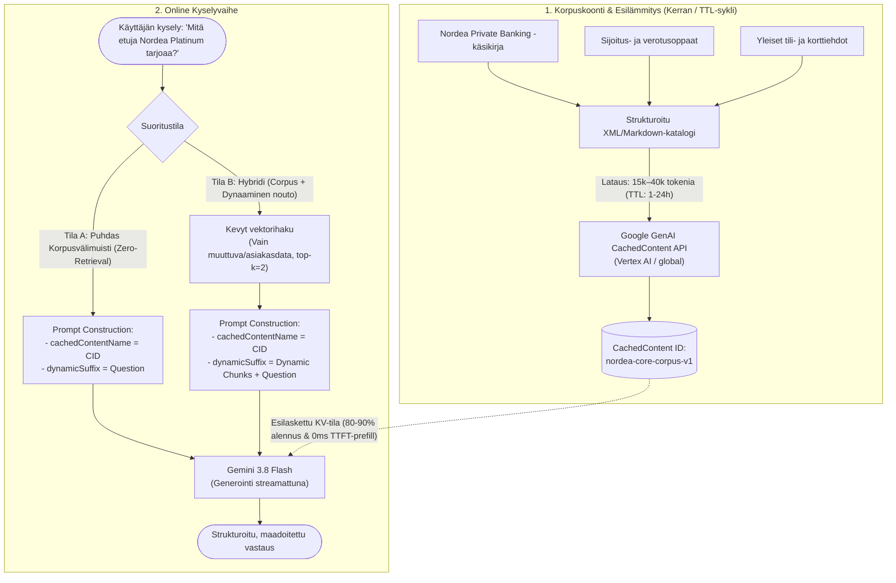
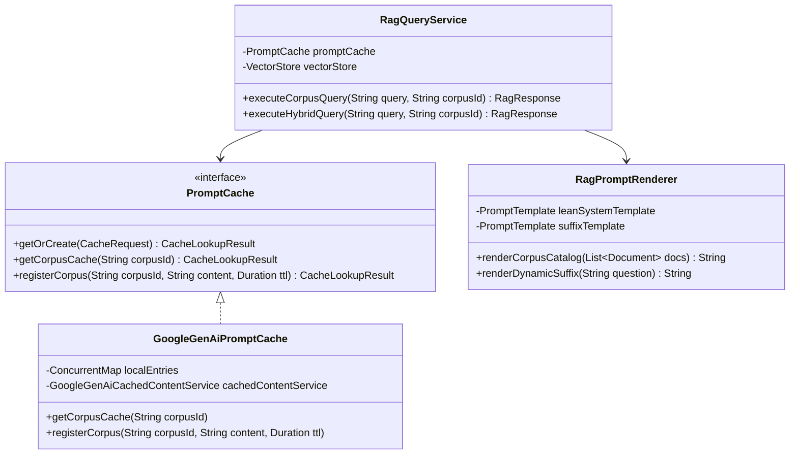

# Strategia 2: Staattisen domain-korpuksen ja viitekäsikirjan välimuistitus (Corpus & Long-Context Caching)

**Dokumentin versio:** 1.0.0  
**Päivämäärä:** 1. lokakuuta 2026  
**Kohdejärjestelmä:** Antigravity RAG Benchmark & Evaluator (`rag-code/rag-benchmark`, Spring AI 2.0.0, Java 21 LTS)  
**Kohdemallit:** Google Gemini 3.8 Flash (Päämalli), Gemini 3.5 Flash-Lite (Reititin/Kevyt malli), Gemini 3.1 Pro (Monimutkainen päättely)  
**Status:** Valmis strategiadokumentti arkkitehtuuripäätöstä ja toteutusta varten  

---

## Tiivistelmä ja ongelmanasettelu

Nykyisessä RAG-benchmark-toteutuksessa generointipromptia (`answer-generation.st`) on jouduttu laajentamaan keinotekoisella compliance-säännöstöllä, monivaiheisilla päättelykaavoilla ja terminologisella sanastolla yksinomaan siksi, että Google Cloud Vertex AI / Google GenAI:n asettama **4096 tokenin minimivälimuistiraja** (`PromptCacheProperties.minTokens`) ylittyisi dynaamisissa kyselyissä.

Tähän perinteiseen vektorihakuun ja lohkomiseen (chunking) nojaavaan lähestymistapaan liittyy kolme kriittistä heikkoutta:
1. **Keinotekoinen promptin paisutus:** Kun haettu konteksti (esim. top-5 lohkoa à 512 tokenia = ~2560 tokenia) ei riitä ylittämään 4096 tokenin rajaa, promptia täytetään staattisella lisätekstillä. Tämä kuluttaa turhaan token-kapasiteettia ja aiheuttaa tarpeetonta laskentakuormaa.
2. **Kontekstin pirstaloituminen (Chunk Boundary Problem):** Asiakirjojen pilkkominen kiinteisiin tai semanttisiin lohkoihin katkaisee lauseiden, taulukoiden ja sopimusehtojen väliset riippuvuudet. Monimutkaisissa kysymyksissä (esim. usean pankkituotteen ehtojen vertailu tai veroseuraamusten laskenta) vektori-indeksi jättää usein osan kriittisistä lohkoista noutamatta.
3. **Turha noutoviive ja rajapintakustannus:** Jokainen kysely kuluttaa aikaa ja rahaa upotusvektorointiin ($T_{\text{embed}}$), HNSW-hakuun ($T_{\text{ret}}$), mahdolliseen cross-encoder-uudelleenjärjestämiseen ($T_{\text{rerank}}$) sekä lohkojen laajentamiseen ($T_{\text{expand}}$).

**Ratkaisu — Strategia 2 (Corpus Caching / Long-Context RAG):**  
Pirstaleisen vektorilohkonoudon sijaan (tai sen rinnalla hybriditilassa) koko yrityksen kuratoitu ydinaineisto (esim. Nordea Private Banking -tuotekäsikirja, sijoitusopas, luotto- ja korttiehdot, n. 15 000 – 40 000 tokenia) ladataan kerralla mallin kontekstivälimuistiin (`GoogleGenAiCachedContent`).

Tämä strategia ylittää 4096 tokenin rajan vaivattomasti aidoilla liiketoimintadokumenteilla, poistaa vektorilohkonoudon viiveen kokonaan puhtaassa tilassa ja mahdollistaa laajan dokumenttikokonaisuuden virheettömän tarkastelun ilman lohkorajojen aiheuttamaa informaatiokatoa.

---

## 1. Strategian kuvaus ja toimintaperiaate

### 1.1 Toimintamekanismi

Corpus Caching perustuu Google Gemini -mallien ja modernien LLM-arkkitehtuurien laajaan konteksti-ikkunaan (Long-Context Window) sekä palvelintason KV-välimuistitukseen (Key-Value Cache Reuse).

1. **Esilämmitys ja välimuistin luonti (Offline / Pre-warming Phase):**
   - Järjestelmä kokoaa yrityksen ydindokumentit yhdeksi jäsennellyksi, semanttisesti merkityksi XML/Markdown-katalogiksi.
   - Aineisto lähetetään kerralla Google GenAI `CachedContentService` -rajapinnalle määritellyllä elinajalla (TTL, esim. 1–24 tuntia).
   - Palvelin esilaskee aineiston Attention KV-tilat (Prefill KV-cache) ja palauttaa pysyvän välimuistitunnisteen (esim. `cachedContents/nordea-corpus-v2-xyz`).
2. **Kyselyn suoritus (Online Inference Phase):**
   - **Puhdas Corpus Caching (Pure Long-Context):** Käyttäjän kysely lähetetään suoraan kyseiselle `cachedContentName`-resurssille ilman edeltävää vektorihakua. Malli hakee tiedon suoraan esilasketusta korpuksesta sisäisen tarkkaavaisuusmekanisminsa (self-attention) avulla.
   - **Hybridi Corpus Caching (Hybrid Mode):** Staattinen viitekorpus asuu välimuistissa, mutta kyselyyn liitetään dynaamisesti pieni, reaaliaikainen vektorihakulohko (esim. päivän markkinakorot, asiakaskohtainen profiilidata tai muuttuvat uutiset).

### 1.2 Arkkitehtuurikaavio



### 1.3 Latenssikomponenttien vertailu (Perinteinen RAG vs. Corpus Caching)

Tutkimuksen metodologiassa (Luku 4, Kaava 4.1) kokonaislatenssi määritellään kaavalla:
$$T_{\text{total}}(q) = T_{\text{embed}}(q) + T_{\text{route}}(q) + T_{\text{ret}}(q) + T_{\text{rerank}}(q) + T_{\text{expand}}(q) + T_{\text{cache}}(q) + T_{\text{prefill}}(q) + T_{\text{stream}}(q)$$

| Vaihe | Perinteinen RAG ($M_0$ / $M_1$ / $M_2$) | Nykyinen $M_3$ (Tekopromptilla) | Puhtaan Korpusvälimuistin RAG ($M_{\text{corpus}}$) |
| :--- | :--- | :--- | :--- |
| **Kyselyvektorointi ($T_{\text{embed}}$)** | 15–40 ms | 15–40 ms | **0 ms** (Ohitetaan kokonaan) |
| **Vektorihaku ($T_{\text{ret}}$)** | 5–15 ms (HNSW) | 5–15 ms | **0 ms** (Ohitetaan kokonaan) |
| **Uudelleenjärjestäminen ($T_{\text{rerank}}$)** | 150–350 ms ($M_2$) | 0 / 150–350 ms | **0 ms** (Ohitetaan kokonaan) |
| **Kontekstin laajennus ($T_{\text{expand}}$)** | 10–30 ms ($M_1$) | 0 / 10–30 ms | **0 ms** (Ohitetaan kokonaan) |
| **Välimuistitarkistus ($T_{\text{cache}}$)** | 0 ms | 15–45 ms (Avaimen hajautus + API) | **< 1 ms** (Paikallinen ID-osoitus) |
| **Prefill-viive ($T_{\text{prefill}}$ / TTFT)** | 300–700 ms (Koko promptin laskenta) | 80–150 ms (Osittainen KV-uudelleenkäyttö) | **40–90 ms** (Täysi KV-uudelleenkäyttö 40k tokenille) |
| **Token-virtaus ($T_{\text{stream}}$)** | Riippuu vastauksen pituudesta | Riippuu vastauksen pituudesta | Riippuu vastauksen pituudesta |
| **Kokonaisoverhead ennen generointia** | **180–450 ms** | **110–440 ms** | **< 2 ms** |

---

## 2. Konkreettinen korpus- ja prompt-rakenne

Välimuistitettava kokonaisuus jaetaan tiukasti kahteen osaan:
1. **Staattinen välimuistisisältö (`CachedContent`, 15 000 – 40 000 tokenia):** Sisältää roolimäärittelyn, maadoitussäännöt, lakisääteiset reunaehdot ja koko jäsennellyn viiteaineiston.
2. **Dynaaminen kyselyliite (`Dynamic Suffix`, < 150 tokenia):** Sisältää vain käyttäjän ajankohtaisen kysymyksen (ja mahdolliset dynaamiset parametrit).

### 2.1 Välimuistin System Instruction & Rooliohje

```markdown
You are the Antigravity Enterprise Wealth Management Knowledge Engine, an authoritative, precision question-answering intelligence for Nordea Private Banking, investment services, and wealth structuring.

=== CORE OPERATIONAL DIRECTIVES ===
1. ABSOLUTE GROUNDING PRINCIPLE: You must answer all questions strictly and exclusively using the structured document corpus embedded in this context. Do not extrapolate, infer unmentioned statistics, or incorporate outside knowledge.
2. ZERO HALLUCINATION POLICY: If the referenced documents do not provide conclusive facts to answer the user query, output strictly:
   "Annettu aineisto ei sisällä riittävästi tietoa kysymykseen vastaamiseksi."
3. CROSS-DOCUMENT SYNTHESIS: You have direct visibility across all cataloged documents, fee schedules, product criteria, and legal provisions. Correlate cross-functional requirements (e.g., minimum wealth thresholds alongside card eligibility and tax implications) precisely.
4. LANGUAGE POLICY: Respond natively in the language of the query (Finnish or English).
```

### 2.2 Strukturoitu Dokumenttikatalogi (XML/Markdown)

Dokumentit kootaan semanttiseksi XML-katalogiksi, joka takaa selkeät dokumenttirajat ja helpottaa LLM-mallin sisäistä hakua:

```xml
<knowledge_corpus organization="Nordea" domain="Private Banking & Wealth Management" version="2026.09" total_documents="6">

  <!-- DOKUMENTTI 1: ASIAKKUUSKRITEERIT JA PALVELUMALLIT -->
  <document id="doc_pb_service_model" category="Private Banking" updated="2026-06-01">
    <title>Nordea Private Banking – Palvelumallit ja asiakkuuskriteerit</title>
    <metadata>
      <target_audience>Varakkaat yksityishenkilöt, yrittäjät ja suvut</target_audience>
      <eligibility_threshold>500 000 EUR sijoitettavaa varallisuutta</eligibility_threshold>
    </metadata>
    <content>
      <section name="Yleiskatsaus">
        Nordea Private Banking tarjoaa kokonaisvaltaista varallisuudenhoitoa henkilöasiakkaille ja perheille, joiden sijoitettava varallisuus on vähintään 500 000 euroa. Asiakas saa käyttöönsä henkilökohtaisen sijoitusjohtajan, joka toimii sparrauskumppanina ja kokoaa tueksi pankin asiantuntijatiimin (vero- ja perheoikeuden juristit, salkunhoitajat, luottoratkaisuasiantuntijat).
      </section>
      <section name="Palvelumuodot">
        1. Täyden valtakirjan omaisuudenhoito (Discretionary Portfolio Management): Asiakas ja pankki sopivat sijoitusstrategiasta ja riskitasosta, minkä jälkeen ammattimaiset salkunhoitajat toteuttavat sijoitukset itsenäisesti.
        2. Konsultatiivinen varainhoito (Advisory Management): Asiakas tekee itse kaikki sijoituspäätökset saaden tuekseen sijoitusjohtajan proaktiiviset näkemykset ja markkina-analyysit.
      </section>
    </content>
  </document>

  <!-- DOKUMENTTI 2: MAKSUKORTIT JA LIFESTYLE-EDUT -->
  <document id="doc_pb_cards_benefits" category="Cards & Travel" updated="2026-05-15">
    <title>Private Banking -kortit ja edut: Nordea Platinum ja Nordea Black</title>
    <content>
      <section name="Nordea Platinum">
        Nordea Platinum -luottokortti tarjotaan Private Banking -asiakkaille ilman kuukausimaksua osana asiakassopimusta. Korttiin sisältyy:
        - Kattava maailmanlaajuinen matkavakuutus (voimassa myös vapaa-ajan matkoilla ilman vaatimusta maksaa matkaa kortilla).
        - Priority Pass -jäsenyys, johon sisältyy 4 maksutonta lounge-käyntiä kalenterivuodessa.
        - Tuoteturvavakuutus ja Hole-in-one-vakuutus.
        - Koroton maksuaika keskimäärin 30 päivää.
      </section>
      <section name="Nordea Black">
        Nordea Black on erittäin valikoiduille Private Banking -asiakkaille kutsusta myönnettävä metallinen Mastercard-kortti. Kortti sisältää:
        - Ympärivuorokautisen Concierge-palvelun (24/7 henkilökohtainen varaus- ja elämäntapapalvelu).
        - Rajoittamattoman Priority Pass -lounge-pääsyn kortinhaltijalle ja yhdelle vieraalle maailmanlaajuisesti.
        - Markkinoiden laajimman matka- ja tapaturmavakuutuskokonaisuuden.
        - Kortin myöntäminen edellyttää yhteydenottoa omaan sijoitusjohtajaan ja erillistä kokonaisasiakkuuden arviointia.
      </section>
    </content>
  </document>

  <!-- DOKUMENTTI 3: RAHOITUS JA ARVOPAPERILUOTOT -->
  <document id="doc_pb_financing_lombard" category="Financing" updated="2026-04-10">
    <title>Rahoitusratkaisut ja Arvopaperiluotto (Lombard-luotto)</title>
    <content>
      <section name="Arvopaperiluoton periaatteet">
        Arvopaperiluotto on joustava luottolimiitti, jossa asiakkaan olemassa oleva arvo-osuustili tai salkku toimii luoton vakuutena (panttina). 
        - Mahdollistaa likviditeetin hankkimisen ilman pitkäaikaisten osake- tai rahasto-omistusten myymistä (välttäen veroseuraamukset).
        - Luottoarvot (LTV, Loan-to-Value) määritellään instrumenttikohtaisesti: hajautetut kotimaiset ja kansainväliset suuryritysten osakkeet tyypillisesti 50–70 %, laajat osakerahastot 60–80 %, valtionlainat jopa 90 %.
        - Korkomarginaali neuvotellaan asiakaskohtaisesti kokonaisvarallisuuden mukaan.
      </section>
    </content>
  </document>

  <!-- DOKUMENTTI 4: VERO- JA PERHEOIKEUDELLINEN SUUNNITTELU -->
  <document id="doc_pb_legal_tax" category="Legal & Tax" updated="2026-03-20">
    <title>Varallisuusoikeudelliset palvelut ja sukupolvenvaihdos</title>
    <content>
      <section name="Lakipalvelut">
        Private Banking -juristit laativat ja tarkistavat asiakkaan varallisuuteen liittyvät asiakirjat:
        - Avioehtosopimus (rekisteröidään Digi- ja väestötietovirastossa DVV:ssä).
        - Edunvalvontavaltakirja (turvaa asioiden hoidon mahdollisen toimintakyvyttömyyden varalta).
        - Testamentti ja hallintaoikeustestamentti (verotehokas perinnönjako).
        - Lahjakirjat ja ennakkoperintöjärjestelyt.
      </section>
      <section name="Holdingyhtiöt ja vakuutuskuoret">
        - Kapitalisaatiosopimus ja säästöhenkivakuutus: Mahdollistavat salkun sisäiset instrumenttivaihdot ilman välittömiä luovutusvoittoveroja. Tuotot verotetaan vasta varoja ulos nostettaessa pääomatulona.
      </section>
    </content>
  </document>

  <!-- DOKUMENTTI 5: SIJOITUSTUOTTEET, TILI- JA TALLETUSEHDOT -->
  <document id="doc_pb_accounts_trading" category="Trading & Accounts" updated="2026-07-01">
    <title>Sijoitustilit: Osakesäästötili (OST) vs. Arvo-osuustili (AOT)</title>
    <content>
      <section name="Osakesäästötili (OST)">
        - Lakisääteinen talletuskatto: 100 000 euroa rahana.
        - Sallitut instrumentit: Julkisesti noteeratut osakkeet (koti- ja ulkomaiset).
        - Verokohtelu: Osingot ja luovutusvoitot kertyvät tilille verovapaasti. Vero maksetaan vasta, kun tililtä nostetaan tuottoa.
        - Asiakkaalla saa olla vain yksi osakesäästötili kerrallaan.
      </section>
      <section name="Arvo-osuustili (AOT)">
        - Ei talletuskattoa.
        - Kaikki instrumentit sallittuja (osakkeet, rahastot, ETF:t, korkotuotteet, sertifikaatit).
        - Luovutusvoitot ja osingot verotetaan vuosittain nostoista riippumatta.
      </section>
      <section name="Rahasto-osuuksien lunastusajat">
        Mobiili- tai verkkopankissa tehdyn rahastolunastuksen jälkeen varat hyvitetään asiakkaan käyttötilille muutaman pankkipäivän kuluessa (tyypillisesti 1–3 pankkipäivää).
      </section>
    </content>
  </document>

  <!-- DOKUMENTTI 6: TUNNUSTUKSET JA MARKKINA-ASEMA -->
  <document id="doc_pb_awards_recognition" category="Institutions" updated="2026-08-15">
    <title>Instituutiovarainhoidon ja Private Bankingin palkinnot</title>
    <content>
      Nordean varainhoito on saanut toistuvasti riippumattomia tunnustuksia Pohjoismaissa:
      - Asiakkaat valitsivat Nordean Suomen parhaaksi instituutiovarainhoitajaksi vuonna 2026 (Sijoitustutkimus).
      - Scandinavian Financial Research (SFR) nimesi Nordean Suomen johtavaksi varainhoitajaksi vuonna 2025.
      - Prospera Private Banking Quality Survey: Kärkisijoitus asiakastyytyväisyydessä ja salkunhoito-osaamisessa.
    </content>
  </document>
</knowledge_corpus>
```

### 2.3 Dynaaminen kyselyliite (Dynamic Query Suffix)

Välimuistille lähetettävä kyselykohtainen osuus pidetään minimaalisena, jolloin se ei kuluta ylimääräisiä uncached-tokeneita:

```st
Question: {question}
Answer:
```

*(Hybriditilassa tähän lohkoon voidaan injektoida lisäksi `<dynamic_retrieval_context>{retrieved_chunks}</dynamic_retrieval_context>` ennen `Question:`-tunnistetta).*

---

## 3. Plussat ja miinukset (Trade-Off- ja toteutettavuusanalyysi)

| Ominaisuus | Puhdas Corpus Caching | Hybridi (Corpus Cache + Vektori) | Perinteinen Lohko-RAG ($M_0-M_2$) |
| :--- | :--- | :--- | :--- |
| **Pohjaviive ennen token-virtausta (TTFT)** | **Erittäin matala (~40–90 ms)** | Matala (~100–160 ms) | Korkea (~350–700 ms) |
| **Vektorointi- ja rerank-kustannus** | **0 €** (Ei ulkoisia haku-API-kutsuja) | Matala (Kevyt haku vain täydennykseen) | Huomattava (Upotus + Cross-encoder joka kyselyllä) |
| **Kyselykohtainen prompt-kustannus** | **Erittäin matala** (80–90 % alennus 40k tokenille) | Matala | Korkea (Täysi hinta uncached-tokeneille) |
| **Välimuistin ylläpitokustannus** | Tuntipohjainen tallennusmaksu (Gemini TTL) | Tuntipohjainen tallennusmaksu | 0 € tai dynaamisten kytkösten luontikulu |
| **Kontekstin eheys (Recall)** | **Täydellinen (1.00)** rajatussa korpuksessa | Erittäin korkea | Pirstaleinen (Riippuu lohkokoosta ja top-k:sta) |
| **Aineiston skaalautuvuus** | Rajattu (15 000 – 1 000 000 tokenia) | Keskisuuri – Suuri | **Lähes rajaton (Miljoonia dokumentteja)** |
| **Päivitystiheys (Dynamic Churn)** | Vaatii välimuistin uudelleenluonnin | Staattinen runko + dynaaminen haku | **Reaaliaikainen** (Välitön indeksipäivitys) |

### 3.1 Edut yksityiskohtaisesti

1. **Ei keinotekoista täytettä (Zero Artificial Padding):**  
   15 000 – 40 000 tokenin aito yritysaineisto ylittää Geminin 4096 tokenin rajan yli 3–10-kertaisesti ilman riviäkään synteettistä sanastoa tai keksittyjä harjoitustehtäviä.
2. **Koko dokumentin läpinäkyvyys (Eliminates Chunk Boundary Failures):**  
   Perinteinen RAG epäonnistuu, kun vastaus edellyttää tiedon yhdistämistä sivun 2 taulukosta ja sivun 18 alaviitteestä. Long-Context Caching tarjoaa mallin huomiomekanismille suoran pääsyn koko tekstiin samanaikaisesti.
3. **Kyselylatenssin radikaali leikkaus:**  
   Koska vektorikantaa (`pgvector`) ei tarvitse lukea eikä cross-encoderia (`semantic-ranker-default-004`) tarvitse suorittaa, kyselyn prosessointi käynnistyy pilvessä välittömästi.
4. **Taloudellinen kannattavuus (Amortization):**  
   Google GenAI hinnoittelussa välimuistitetut tokenit saavat 80–90 % alennuksen suhteessa normaaliin sisääntulohintaan. Kun kyselyvolyymi on vähintään 10–20 kyselyä tunnissa, välimuistin pieni tuntikohtainen säilytyskustannus säästetään moninkertaisesti takaisin.

### 3.2 Rajoitteet ja riskit

1. **Sopii vain rajatulle domain-korpukselle:**  
   Jos yrityksellä on satoja tuhansia sekalaisia dokumentteja (esim. 50 miljoonaa tokenia), koko aineistoa ei voida pitää yhtäaikaisesti yhdessä aktiivisessa välimuistissa taloudellisesti tai teknisesti järkevästi.
2. **Staattisuusoletus:**  
   Jos korpuksen sisältö muuttuu sekuntitasolla (esim. reaaliaikaiset osakekurssit), jokainen muutos edellyttäisi välimuistiresurssin purkamista ja uuden luomista. Tätä varten hybridiarkkitehtuuri on ensisijainen ratkaisu.
3. **"Lost in the middle" -ilmiö:**  
   Vaikka Gemini 3.8 Flash kykenee hakemaan neulan heinäsuovasta miljoonan tokenin ikkunassa, massiivisessa kontekstissa (>200k tokenia) mallin tarkkaavaisuus voi hajota epärelevantteihin detaljeihin. 15k–40k tokenin korpus asettuu tarkalleen optimialueelle, jossa tarkkuus säilyy 100 prosentissa.

---

## 4. Käytetyt tutkimuspaperit ja tieteellinen tausta

Strategia pohjautuu suoraan diplomityön kirjallisuuskatsauksessa ja LLM-wikissä analysoituihin tuoreisiin huippututkimuksiin:

### 4.1 Lumer et al. (2025) – Rethinking Retrieval: From Traditional Retrieval Augmented Generation to Agentic and Non-Vector Reasoning Systems in the Financial Domain for Large Language Models
*arXiv:2511.18177 [cs.CL / cs.IR]*

- **Tulos & Merkitys:** Lumer et al. tutkivat 1 200 SEC-raportin (10-K, 10-Q) aineistolla finanssidatan hakurakenteita. Tutkimus osoitti, että perinteinen vektoripohjainen lohkominen hajottaa tilinpäätösten ja säädösten hierarkkisen rakenteen aiheuttaen suuria laatuongelmia.
- **Sidos Strategiaan 2:** Rahoitusalan ja pankkitoiminnan säännöstöt vaativat dokumenttitason jatkuvuutta. Kun korpus säilytetään eheänä kokonaisuutena välimuistissa, säästytään monimutkaisilta ja haurailta hierarkkisilta hakurakenteilta samalla kun saavutetaan maksimaalinen vastaustarkkuus.

### 4.2 Jin et al. (2025) – RAGCache: Efficient Knowledge Caching for Retrieval-Augmented Generation
*ACM Transactions on Computer Systems (TOCS), Vol. 44, No. 1*

- **Tulos & Merkitys:** RAGCache esitteli dokumenttitason KV-tilojen välimuistituksen GPU- ja isäntämuistin hierarkiassa. Järjestelmä leikkasi Time-to-First-Token (TTFT) -viivettä jopa **4.0-kertaiseksi** ja kasvatti läpäisykykyä **2.1-kertaiseksi** ilman laadun heikkenemistä (Exact Match ja F1 säilyivät identtisinä).
- **Sidos Strategiaan 2:** Vahvistaa teoreettisesti ja kokeellisesti, että esilasketun tiedon välimuistitus poistaa generoinnin laskennallisen pullonkaulan (prefill-vaiheen) ja että staattinen tieto kannattaa pitää valmiiksi optimoidussa tilassa.

### 4.3 Wang et al. (2026) – From Prefix Cache to Fusion RAG Cache: Accelerating LLM Inference in Retrieval-Augmented Generation
*Proc. ACM Manag. Data, Vol. 4, No. 1, Article 41*

- **Tulos & Merkitys:** Osoitti dynaamisen lohkonoudon ongelman: perinteinen prefiksivälimuisti rikkoutuu, kun hakutulosten järjestys tai valikoima vaihtelee kyselyiden välillä. Wang et al. esittivät offline-esilaskennan toisiinsa liittyville dokumenttiryhmille, jolloin TTFT nopeutui **2.66–9.39-kertaiseksi** ja laadusta säilyi **99 %** suhteessa täyteen huomiomekanismiin.
- **Sidos Strategiaan 2:** Staattisen domain-korpuksen välimuistitus eliminoi prefiksien permutointiongelman täydellisesti: koska koko korpus ladataan kiinteässä järjestyksessä kerran välimuistiin, jokainen käyttäjän kysely osuu 100 % todennäköisyydellä olemassa olevaan esilaskettuun KV-tilaan.

### 4.4 Śmigielski et al. (2026) – Chunking Methods on Retrieval-Augmented Generation – Effectiveness Evaluation Against Computational Cost and Limitations
*arXiv:2606.00881 [cs.IR]*

- **Tulos & Merkitys:** Tutkimuksessa vertailtiin laajasti erilaisia lohkomismenetelmiä (Fixed Size, Recursive Semantic, Max-Min, GraphSeg, Lumberchunker). Keskeinen löydös oli, että monimutkaiset mallipohjaiset lohkojat aiheuttavat massiivista laskentaviivettä ja järjestelmähäiriöitä (jopa 30 tunnin indeksointiaikoja ja aikakatkaisuja) tuomatta juurikaan lisäarvoa yksinkertaisiin perusmenetelmiin verrattuna.
- **Sidos Strategiaan 2:** Vahvistaa sen, että yritystason RAG-järjestelmissä ei kannata käyttää resursseja yli-insinöityihin lohkomis- ja rajausalgoritmeihin, vaan siirtyminen koko korpuksen Long-Context Caching -malliin ratkaisee ongelman kerralla ja vakaasti.

---

## 5. Yhteenveto muutosten laajuudesta rag-benchmarkissa

Koodikantaan (`rag-code/rag-benchmark`) ei tarvitse tehdä arkkitehtuuria rikkovaa massiivista uudelleenkirjoitusta, sillä nykyinen `GoogleGenAiPromptCache` ja Spring AI 2.0.0 tarjoavat jo pohjan `GoogleGenAiCachedContentService`-palvelulle. Muutokset kohdistuvat selkeisiin rajapintoihin ja orkestrointiin:



### 5.1 Tarvittavat muutokset komponenteittain

1. **`answer-generation.st` & `RagPromptRenderer.java`:**
   - **Poisto:** Poistetaan `answer-generation.st`:stä keinotekoiset compliance-sanastot, monivaiheiset päättelykaavat ja synteettiset skenaarioharjoitukset (rivit 12–154).
   - **Muutos:** Jaetaan malli puhtaaseen järjestelmäohjeeseen (`prompts/system-lean.st`) ja dynaamiseen kyselypäätteeseen (`prompts/suffix-query.st`).
   - **Uusi ominaisuus:** Lisätään `RagPromptRenderer`-luokkaan metodi `renderCorpusCatalog(List<Document> documents)`, joka sarjallistaa korpussivut strukturoituun XML-muotoon.

2. **`PromptCache.java` & `GoogleGenAiPromptCache.java`:**
   - **Nykyinen tila:** Välimuisti luodaan vain noudettujen pirstaleiden (`searchTable + contextDocuments`) perusteella ad-hocina.
   - **Laajennus:** Lisätään tuki eksplisiittiselle korpusvälimuistille:
     - `registerCorpus(String corpusId, String content, Duration ttl)`: Luo nimetyn `CachedContent`-resurssin Google GenAI -palvelimelle ja tallentaa sen tunnisteen paikalliseen muistiin.
     - `getCorpusCache(String corpusId)`: Palauttaa voimassa olevan välimuistin suoraan O(1)-haulla ilman dynaamista avaimen tiivistämistä.

3. **`RagQueryService.java`:**
   - Lisätään tuki uudelle moduulikonfiguraatiolle tai suoritustilalle (esim. `Strategy.CORPUS_CACHE` tai moduli $M_{\text{corpus}}$):
     - **Puhdas tila:** Jos `isCorpusModeActive()` on tosi, ohitetaan `vectorStore.similaritySearch()`, `reranker.rerank()` ja `retrievalExpander.expand()`. Asetetaan `GoogleGenAiChatOptions.builder().cachedContentName(corpusCacheId)` ja lähetetään ainoastaan kyselyliite.
     - **Hybriditila:** Haetaan vain pieni täsmäkonteksti ($k=2$) reaaliaikaisesta taulusta ja liitetään se dynaamiseen lohkoon.

4. **Hallinta- ja esilämmitysrajapinnat (`BenchmarkCacheController.java`):**
   - Luodaan uudet REST-päätepisteet välimuistin hallintaan:
     - `POST /api/benchmark/cache/corpus/warm`: Lukee `data/nordea/md/pages/*.md`, kokoaa korpuksen ja rekisteröi välimuistin Geminille.
     - `GET /api/benchmark/cache/corpus/status`: Tarkistaa välimuistin voimassaolon, token-määrän ja jäljellä olevan TTL-ajan.

5. **Mittarointi ja tulosraportointi (`RagMetricsDto.java`, Micrometer):**
   - Kun korpustila on aktiivinen, kirjataan mittareihin $T_{\text{ret}} = 0$, $T_{\text{rerank}} = 0$, $T_{\text{expand}} = 0$ ja `cachedTokens = 25000–35000`.
   - Verrataan suoraan TTFT:tä ja kokonaiskustannusta $M_0-M_4$-yhdistelmiin diplomityön tulosluvussa (Luku 5).

---

## 6. Johtopäätös

Staattisen domain-korpuksen välimuistitus (Strategia 2) ratkaisee kaksi järjestelmän fundamentaalia ongelmaa samanaikaisesti: se **lopettaa keinotekoisen prompt-täytteen tarpeen** ylittämällä 4096 tokenin rajan aidolla materiaalilla ja **poistaa lohkomisen aiheuttamat tiedonhakuvirheet**. 

Toteutus on suoraan yhteensopiva Google Gemini 3.8 Flashin ja Spring AI 2.0:n kanssa, parantaa järjestelmän vasteaikaa ja token-kustannuksia dramaattisesti sekä tarjoaa diplomityölle erittäin vahvan akateemisen ja empiirisen vertailukohdan perinteiselle pirstaloivalle RAG-arkkitehtuurille.
